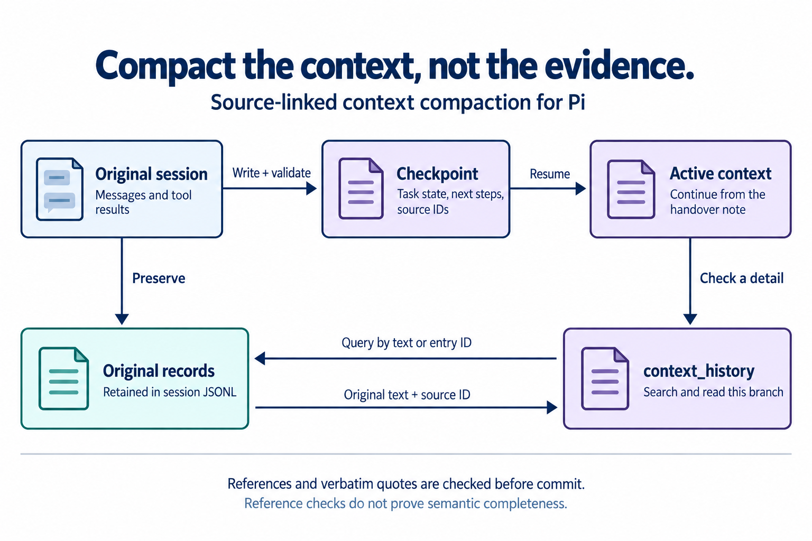
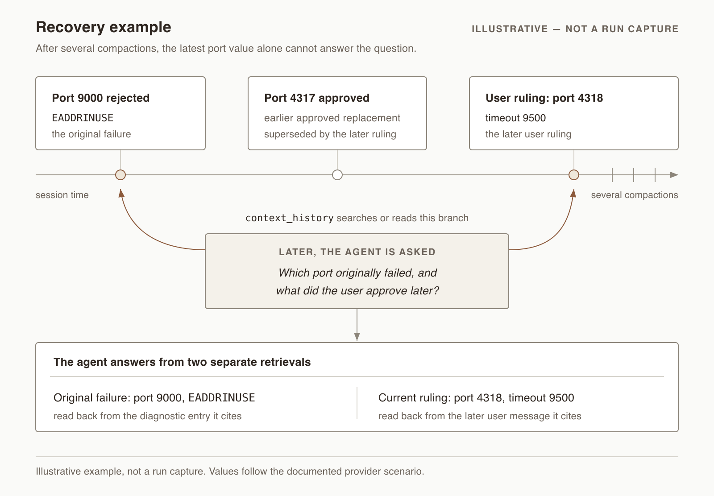
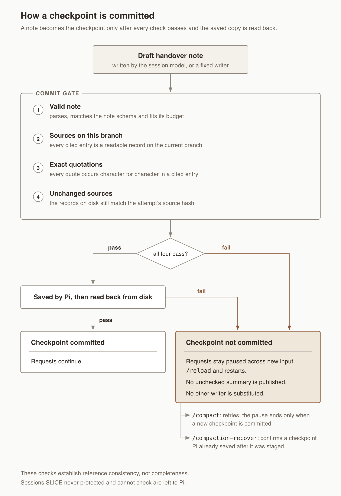

# Pi Context Compaction

**Compact the context, not the evidence.**

Long coding sessions often depend on decisions made much earlier: a failed attempt, a change of direction, a constraint the user added halfway through. A compacted summary can carry the work forward, but it rarely says where those decisions came from.

Pi Context Compaction explores a more traceable handover for [Pi](https://github.com/earendil-works/pi). It writes a structured note with references to the original session records, checks those references before the checkpoint is committed, and gives the agent a way to read the earlier messages again when a detail matters.

The goal is **continuity with a route back to the source**, not perfect memory.

**Current release:** [v0.3.2](https://github.com/youxi-huang/pi-context-compaction/releases/tag/v0.3.2) is an **independent extension preview** for unmodified official **Pi 1.1.0**. It compacts on request (`/compact`) in persistent, text-only sessions. It does **not** compact automatically.

[Install](#install-in-pi) · [First use](#your-first-session) · [How it works](#how-it-works) · [Scope](#what-this-preview-supports) · [Recovery](#when-something-goes-wrong) · [Evidence](#what-has-been-tested)

## Install in Pi

You need:

- Official [Pi](https://github.com/earendil-works/pi) **1.1.0**, already installed and working with your chosen model.
- **Node.js 22.19 or newer**.
- macOS or Linux. Windows has not been validated.

Install the **fixed v0.3.2 extension package** from your terminal:

```sh
pi install git:github.com/youxi-huang/pi-context-compaction@extension-v0.3.2
```

That is the whole installation. You don't need to clone this repository, rebuild Pi or configure a second model. Restart Pi afterwards.

**Why `extension-v0.3.2` and not `v0.3.2`?** They are different Git tags. `extension-v0.3.2` holds the small installable package. `v0.3.2` marks the development source tree, which is not a Pi package. The repository's default branch is the source tree too, so install by package tag (or by the `extension-preview` branch described [below](#update-or-remove)).

The extension does not replace Pi's executable or copy its credentials. Authentication stays in Pi's own configuration.

## Your first session

Start a **new, persistent, text-only** Pi session. Don't begin with an older session that already has native compaction checkpoints or image attachments. Those are outside this preview's scope, and v0.3.2 may block requests in such a session.

In Pi, enter:

```text
/compaction-status
```

You should see the extension build, the writer it selected and a `state`. Nothing is sent to a model. `ready` means the extension found nothing blocking; **it does not mean the conversation is long enough to compact yet**.

Keep working normally. Once the session has accumulated enough completed text history, ask for a checkpoint:

```text
/compact
```

Pi decides first whether there is anything to compact. By default it keeps the most recent 20,000 estimated tokens as they are (Pi's `compaction.keepRecentTokens` setting) and only compacts what lies before them. In a short session Pi answers `Nothing to compact (session too small)` before the extension is called. That is Pi saying "not yet", not a failed installation, and you don't need an artificial long conversation just to check that the extension loaded.

After a successful checkpoint, check again:

```text
/compaction-status
```

From then on the agent can use `context_history` to search or read the original entries on the **current session branch**. Those entries stay in the session's JSONL file.

**One change to ordinary Pi behavior:** while the preview is enabled, Pi's automatic compaction is cancelled. When a long session reaches Pi's compaction point, requests pause until you run `/compact` yourself. The extension also pauses background cache warming; normal provider prompt caching is unaffected.

## Why keep the original evidence?

Imagine a task in which port `9000` failed, `4317` was approved as a replacement, and a later user decision moved the service to `4318` with timeout `9500`.

A short handover might keep only the latest port. It could lose the reason for the change, or blur the earlier approval into the later one. A source-linked handover can send the agent back to the original failure and to the later instruction.

That is what the two layers below show: a compact note for continuing the task, and an unchanged session record that can still be consulted.

<picture>
  <source media="(prefers-color-scheme: dark)" srcset="docs/context-memory/assets/source-linked-compaction-dark.png">
  
</picture>

The port example is illustrative. It follows a [documented provider scenario](docs/context-memory/validation.md#real-provider-scenario) and is not a screenshot of an interactive run.

<picture>
  <source media="(prefers-color-scheme: dark)" srcset="docs/context-memory/assets/recovery-example-dark.png">
  
</picture>

## How it works

1. **Write a handover.** By default the session's own model writes a structured note; a fixed writer can be configured instead. The note records task state, decisions, next steps and source references.
2. **Check the note before committing it.** Every cited source must be on the selected branch, every quotation must appear verbatim in the entry it cites, the note must be valid, and the checkpoint must be confirmed in the session file on disk before work continues.
3. **Go back to the record when it matters.** The agent can use `context_history` to find the original entries instead of relying on the latest summary alone.

The session JSONL remains the source of truth. Notes and checkpoints help the agent navigate it; they don't replace it. These checks establish **reference consistency**, not semantic completeness. A note can pass every check and still leave out something important, and the model can still misread what it retrieves.

The diagram below shows the commit checks. It was first drawn for the **resident** build and shows the validation boundary, **not** the preview's full failure and recovery behavior. In the preview, a failed compaction keeps requests paused until an explicit retry or a staged-checkpoint recovery is confirmed on disk.

<picture>
  <source media="(prefers-color-scheme: dark)" srcset="docs/context-memory/assets/commit-gate-dark.png">
  
</picture>

The [architecture](docs/context-memory/architecture.md) covers the note format, budget rules, history access and the commit boundary in detail.

## What this preview supports

The scope is deliberately narrow, so that its behavior can be tested and explained.

**Supported in v0.3.2**

- Official Pi **1.1.0**, with the extension installed independently of Pi.
- Persistent, text-only sessions, either new or already handled by this preview, with one Pi process writing each session.
- Manual `/compact` at a completed text turn, followed by source-linked history retrieval on the same branch.
- The session model as the default note writer, or an explicitly configured fixed writer.
- Pi's ordinary retries after transient provider failures, including connections dropped mid-response.
- Explicit manual recovery for some previously blocked retry sessions and for text-only context-overflow failures, when enough completed history remains.

**Not supported or not yet verified**

- Automatic compaction; sessions with images or other attachments; in-memory sessions (`--no-session`); unfinished tool rounds.
- Migration of native Pi or resident-build checkpoints; parent-history grants; memory across sessions.
- Concurrent writers, competing compactors, other context-rewriting extensions, or any Pi version other than 1.1.0.
- Windows, long-running real-provider reliability, and recovery quality with real models.

In v0.3.2, an unsupported session may have its **requests blocked** rather than fall back to Pi's native compactor. That is intended for sessions the extension is protecting, but it can also affect older sessions it never handled. Improving that is the main open item for the next preview. If you are evaluating the preview, start a fresh text session.

## When something goes wrong

Start with `/compaction-status`. It reports the extension build, the selected writer, checkpoint information, and whether requests are `ready`, `pending` or `blocked`, with a controlled error code.

If a compaction attempt fails because the note, its sources, the writer or the on-disk state could not be checked, **the extension does not publish an unchecked summary or quietly switch to another writer**. Requests stay paused across new input, `/reload` and reopening the session.

Two commands do different jobs:

- **`/compact`** retries the checkpoint once you have fixed the cause. The block clears only after the new checkpoint has been checked and found in the session file.
- **`/compaction-recover`** is narrower. It confirms a checkpoint that Pi **already saved** after the extension staged it, when the final confirmation was interrupted. It cannot turn an unstaged writer failure into a success. In v0.3.2, use it only when `/compaction-status` reports `CONTEXT_PREVIEW_COMMIT_UNCONFIRMED` or `CONTEXT_PREVIEW_PENDING`: run with nothing staged, it records a block of its own that only a successful `/compact` clears.

Sessions with old checkpoints from another compactor, image content or an unsupported Pi version usually need a new session; neither command migrates them. Please keep the original session file. Disabling or removing the extension ends its protection, but it is **not** a verified way to recover a blocked checkpoint.

[Usage and recovery](docs/context-memory/extension-preview.md) lists the exact supported cases, the configuration file and the special recovery conditions.

## Update or remove

Pi records one source per package repository. Installing the same repository with a different tag or branch **replaces** the recorded source; it never adds a second copy. Restart Pi after any install or update.

The installation above is **pinned** to `extension-v0.3.2` and stays there until you install a different package tag.

To follow later previews automatically instead, install the **moving `extension-preview` branch**, which replaces the pinned tag:

```sh
pi install git:github.com/youxi-huang/pi-context-compaction@extension-preview
```

To update only this package when you follow the branch:

```sh
pi update --extension git:github.com/youxi-huang/pi-context-compaction@extension-preview
```

A pinned tag does not move when updated. A plain `pi update` updates **Pi itself**, and `pi update --all` updates Pi and every package. This preview is validated only on Pi 1.1.0, so check the supported version before updating Pi.

To remove the package, whichever tag or branch you installed:

```sh
pi remove git:github.com/youxi-huang/pi-context-compaction
```

Updating or removing the package does not migrate, rewrite or delete sessions, and it leaves other packages and Pi's credentials alone.

The [v0.3.2 release](https://github.com/youxi-huang/pi-context-compaction/releases/tag/v0.3.2) also carries the extension archive, a source archive, checksums and provenance. The preview is distributed through Git, not npm.

## What has been tested

The project publishes failures and limits next to the passing checks. For v0.3.2 the record includes:

| Evidence | Scope |
| --- | --- |
| 147 context checks | 94 resident checks and 53 independent-preview regressions |
| 461 host security and compatibility checks | Synthetic inputs and mocked providers |
| 89 offline evaluator checks | Scripted evaluation, not real-provider quality |
| 26 stock-Pi package and lifecycle checks | Install, update, removal, checkpoint validation, failure and recovery on an isolated official Pi 1.1.0 |
| 83 default-settings scenario checks | Passed, with **17 known gaps** listed openly, including older sessions, notices and long-session overhead |

None of this shows better recovery than native Pi. The preview's acceptance and scenario runs use isolated synthetic and loopback services; they say nothing about real-provider latency, interactive TUI behavior or everyday robustness. Earlier live results belong to the resident build and are not preview results.

The [validation record](docs/context-memory/validation.md) has the scenarios, methods, failed attempts and measured costs. The [roadmap](docs/context-memory/roadmap.md) says what remains open, and the [changelog](CHANGELOG.md) lists unreleased work on the default branch.

## For maintainers and contributors

No source build is needed to use the preview. The default branch is a **development monorepo**; `extension-preview` and the `extension-v*` tags carry the installable package. The separate v0.3.0 **resident** build changes six Pi host files and is kept for development and comparison, not as the normal way to install.

<details>
<summary>Build the resident source for comparison</summary>

Requirements: Node.js 22.19 or newer, npm, Git, curl and tar.

```sh
git clone https://github.com/youxi-huang/pi-context-compaction.git
cd pi-context-compaction
git checkout v0.3.0
npm ci --ignore-scripts
node scripts/context-memory-model-data.mjs
node scripts/stamp-context-memory.mjs
npm run build:offline
node scripts/context-memory-check.mjs
```

The model-data helper downloads the pinned upstream source release, checks its SHA-256 and extracts the public model catalog for the offline build; it does not read Pi configuration or call a model.

To launch the built resident host with ordinary extension discovery disabled:

```sh
node packages/coding-agent/dist/bundle/cli.js --no-extensions
```

This is not an installation of the independent preview and is unrelated to `pi install`. Resident configuration, event logging and compatibility notes are in [Configuration and operation](docs/context-memory/configuration.md).

</details>

To work on the independent preview, start with [the extension guide](docs/context-memory/extension-preview.md), the [agent instructions](AGENTS.md) and the [operations runbook](docs/context-memory/operations.md). Contributions should keep the original evidence, avoid silent fallbacks, and separate synthetic tests from real-provider observations.

Session records stay in local JSONL files, but relevant content is sent to the selected model when a note is written or history is retrieved. Please leave real transcripts, credentials and identifying local paths out of bug reports; a synthetic reproduction and the extension build ID help more. See [CONTRIBUTING.md](CONTRIBUTING.md), [SECURITY.md](SECURITY.md) and [Discussions](https://github.com/youxi-huang/pi-context-compaction/discussions).

The project was first called Pi Context Memory. Source paths under `context-memory`, the `pi-context-memory.json` configuration file, the `contextMemory` API and stored checkpoint identifiers keep that name; the rename needs no migration.

## License and acknowledgments

MIT. Pi keeps its own license and copyright; new context-memory code is under the same license. See the [third-party notices](THIRD_PARTY_NOTICES.md).

The design was inspired in part by OpenAI's [public description](https://learn.chatgpt.com/docs/models) of notes across context windows and retrieval of earlier task messages, and by public community work on agent context management. Codex assisted development. This project is independently maintained and is not an official Pi or OpenAI release; no OpenAI context-management implementation has been copied.

The original Pi README is kept as [UPSTREAM_README.md](UPSTREAM_README.md). Its release and support instructions apply to upstream Pi, not to this project.
